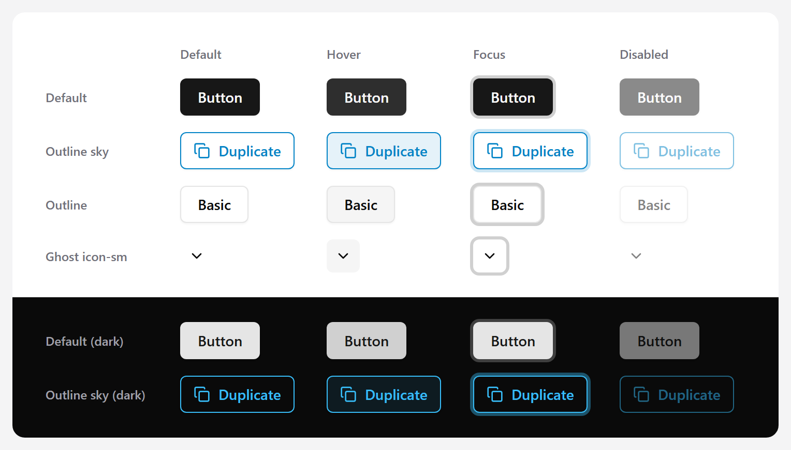

# Buttons

General UI element, not tied to any theme. Plain-CSS equivalent of the shadcn/ui `<Button>` (Tailwind v4, neutral base colour, default size). The preview image is rendered from [buttons.css](buttons.css). After editing the CSS, run `python elements/_preview/render.py` to refresh it.

Themes restyle buttons by overriding the `--btn-*` variables. Dark mode turns on when any ancestor has `class="dark"`, the same convention shadcn uses.

CSS: [buttons.css](buttons.css) · Preview: [buttons.html](buttons.html) · shadcn source: [button-01.tsx](shadcn/button-01.tsx), [button-13.tsx](shadcn/button-13.tsx)

## Variants

| Class                        | shadcn                         | Look                                                                   |
|------------------------------|--------------------------------|------------------------------------------------------------------------|
| `.btn`                       | `<Button>` (button-01)         | solid `#171717`, text `#FAFAFA`; hover at 90% opacity                  |
| `.btn .btn--outline`         | `variant="outline"`            | white, 1px `#E5E5E5` border; hover `#F5F5F5`                           |
| `.btn .btn--outline-sky`     | outline + sky (button-13)      | sky-600 `#0284C7` border and text; hover sky at 10%; dark: sky-400 `#38BDF8` |
| `.btn .btn--ghost`           | `variant="ghost"`              | no border or background; hover `#F5F5F5`                               |
| `.btn--icon` / `.btn--icon-sm` | `size="icon"` / `"icon-sm"`  | square 36px / 32px, icon only (give it an `aria-label`)                |

## Shared spec

- 36px high, 16px horizontal padding (12px when there's an icon), 6px radius, 8px gap between icon and text.
- Text: 14px medium. Icons: 16px.
- Shadow: `0 1px 2px rgba(0,0,0,.05)`. Ghost buttons have none.
- Focus: 3px ring, grey at 50% (sky at 20% on the sky variant).
- Disabled: 50% opacity, not clickable.
