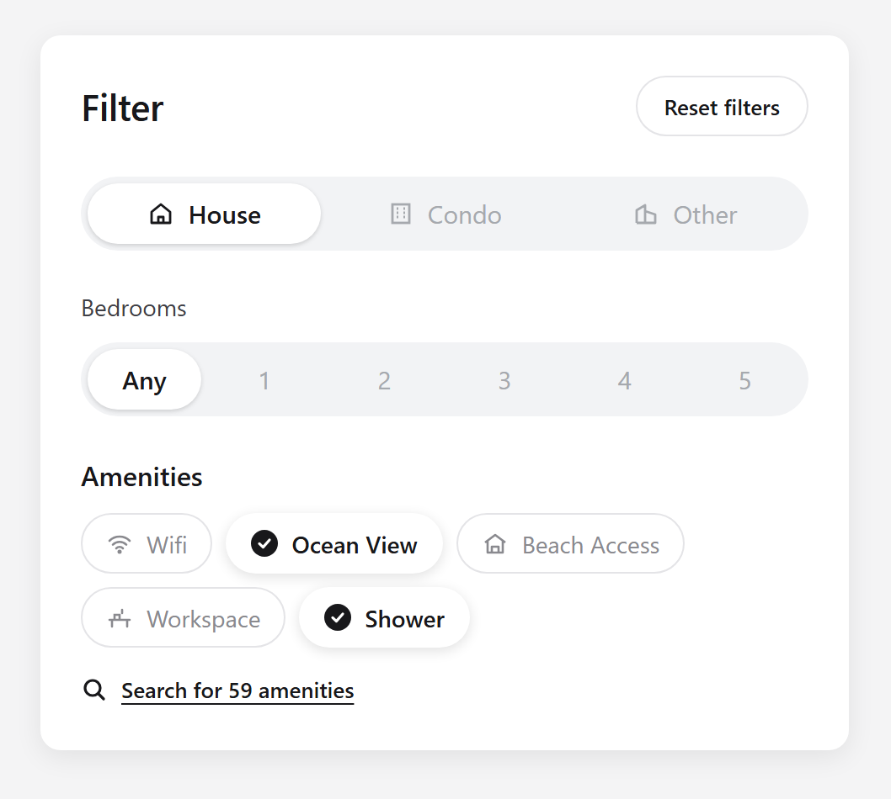
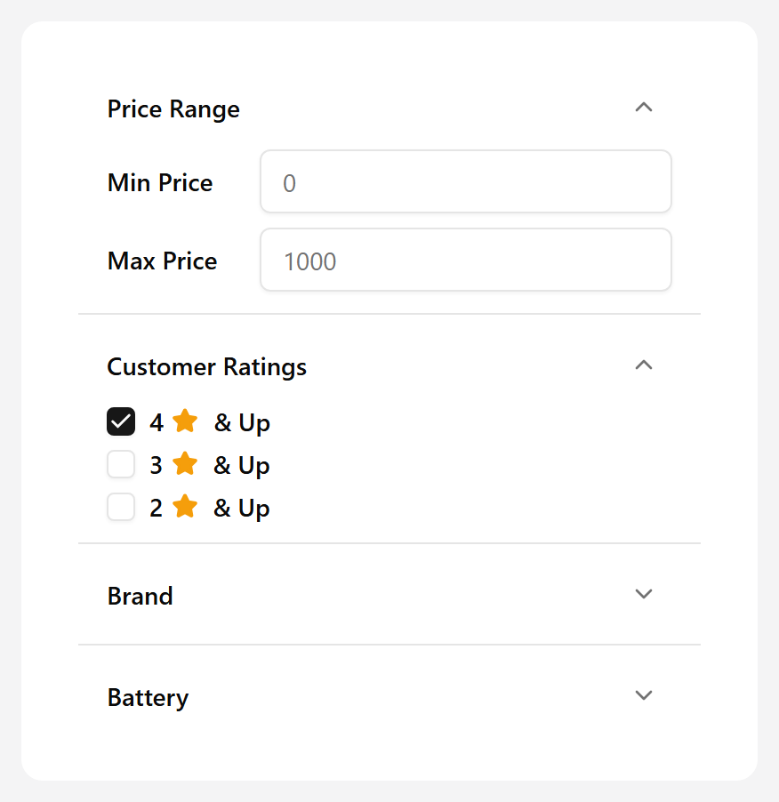

# Filter

A general UI element, not tied to any theme. A filter panel is a card that groups [toggles](../toggles/toggles.md) under section titles:
- **Single choice** (property type, bedrooms): [segmented toggle](../toggles/toggles.md#segmented-toggle-single-choice)
- **Pick any** (amenities): [multi-select toggle (chips)](../toggles/toggles.md#multi-select-toggle-chips)

> Values are estimated from reference screenshots and still need checking against the source design.
> After editing any CSS, run `python elements/_preview/render.py` to refresh the images.

CSS: [filter.css](filter.css), plus [segmented.css](../toggles/segmented.css) and [multiselect.css](../toggles/multiselect.css) · Preview: [filter.html](filter.html)

## Parts

| Part              | Class                    | Style                                                                 |
|-------------------|--------------------------|-----------------------------------------------------------------------|
| Card              | `.filter-card`           | white, 12px radius, 24px padding, shadow `0 4px 16px rgba(0,0,0,.08)` |
| Header            | `.filter-card__header`   | title left, reset button right, 24px gap below                        |
| Title             | `.filter-card__title`    | 22px, semibold, `#18181B`                                             |
| Reset button      | `.filter-reset`          | outlined pill: 36px high, 1px `#E4E4E7` border, 13px medium text      |
| Section           | `.filter-section`        | 24px gap between sections                                             |
| Section title     | `.filter-section__title` | 14px regular `#3F3F46`; use `.filter-section--group` for a 16px medium title (e.g. "Amenities") |
| Section hint      | `.filter-section__hint`  | right-aligned, 12px `#A1A1AA` (e.g. "Avg. price is $1,200")           |
| Search link       | `.filter-search`         | 16px magnifier icon + underlined 13px medium text, 16px above it; shows the total count, e.g. "Search for 59 amenities" |

## Behaviour

- "Reset filters" returns every section to its default: segmented rows back to "Any" or the first option, and all chips off.
- The search link opens the full list of options in that section. Only the most common options are shown as chips.

---

## Collapsible filter

A vertical stack of collapsible sections with separators between them. Each section has a title row with a chevron toggle; inside are either labelled number inputs (a price range) or checkbox lists (ratings, brand, battery). It's the plain-CSS equivalent of shadcn studio "collapsible-05". Use it for long filter lists in a sidebar. The card-style panel above suits short ones.

CSS: [collapsible-filter.css](collapsible-filter.css), plus [buttons.css](../buttons/buttons.css) (ghost chevron) and [forms.css](../forms/forms.css) (checkbox, input, label, separator) · Preview: [collapsible-filter.html](collapsible-filter.html) · shadcn source: [collapsible-05.tsx](shadcn/collapsible-05.tsx)

| Part         | Class                                 | Style                                                                 |
|--------------|---------------------------------------|-----------------------------------------------------------------------|
| Stack        | `.collapsible-filter`                 | up to 350px wide, 12px gap between sections and separators            |
| Section      | `
`       | native open/close, no JS; add `open` to start expanded                |
| Title row    | `
` | title left, chevron right, 16px horizontal padding                    |
| Title        | `.collapsible__title`                 | 14px semibold                                                         |
| Chevron      | `.btn.btn--ghost.btn--icon-sm.collapsible__chevron` | 32px ghost icon button, `#737373`, turns 180° when open |
| Field row    | `.cf-row.cf-row--field`               | label left, input right (input up to 232px wide)                      |
| Checkbox row | `.cf-row`                             | checkbox + label, 8px gap; rows 8px apart                             |
| Rating       | `.cf-rating` + `.cf-star`             | number + 16px filled star, amber-500 `#F59E0B` (dark mode: amber-400 `#FBBF24`) |

- The whole title row is the toggle. Screen readers announce it as expanded or collapsed, because `
` does that natively.
