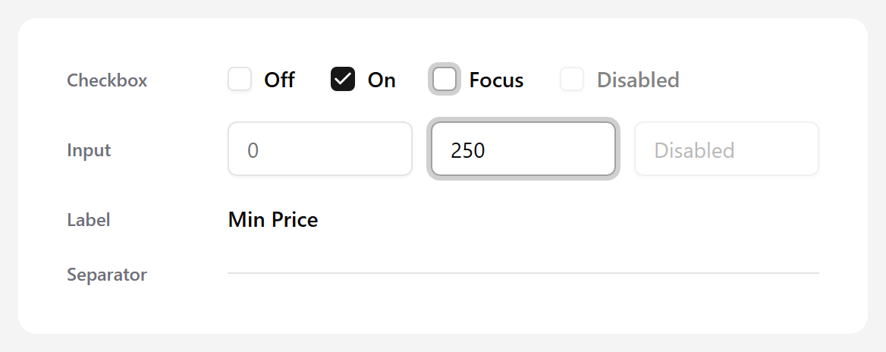

# Form controls

General UI elements, not tied to any theme. Plain-CSS equivalents of shadcn/ui **Checkbox**, **Input**, **Label** and **Separator**, built on native `<input>`, `<label>` and `
`, so they work without JavaScript. The preview image is rendered from [forms.css](forms.css). After editing the CSS, run `python elements/_preview/render.py` to refresh it.

Themes restyle these controls by overriding the `--form-*` variables. Dark mode turns on when any ancestor has `class="dark"`.

CSS: [forms.css](forms.css) · Preview: [forms.html](forms.html)

| Element   | Markup                                    | Spec                                                                                         |
|-----------|-------------------------------------------|----------------------------------------------------------------------------------------------|
| Checkbox  | `<input type="checkbox" class="checkbox">` | 16px square, 4px radius, 1px `#E5E5E5` border. When checked: `#171717` fill with a white check |
| Input     | `<input class="input">`                    | 36px high, 6px radius, 1px `#E5E5E5` border, 12px horizontal padding, 14px text, placeholder `#737373` |
| Label     | `<label class="label" for="…">`            | 14px medium, line-height 1, 8px gap to any inline icon                                       |
| Separator | `
`                   | 1px line in `#E5E5E5`. Use `.separator--vertical` inside flex rows                           |

- Focus (checkbox and input): border turns `#A1A1A1`, with a 3px grey ring at 50%.
- Disabled: 50% opacity, not clickable. A label placed right after a disabled control is dimmed too.
- Invalid input: `aria-invalid="true"` gives it a red border and ring.
