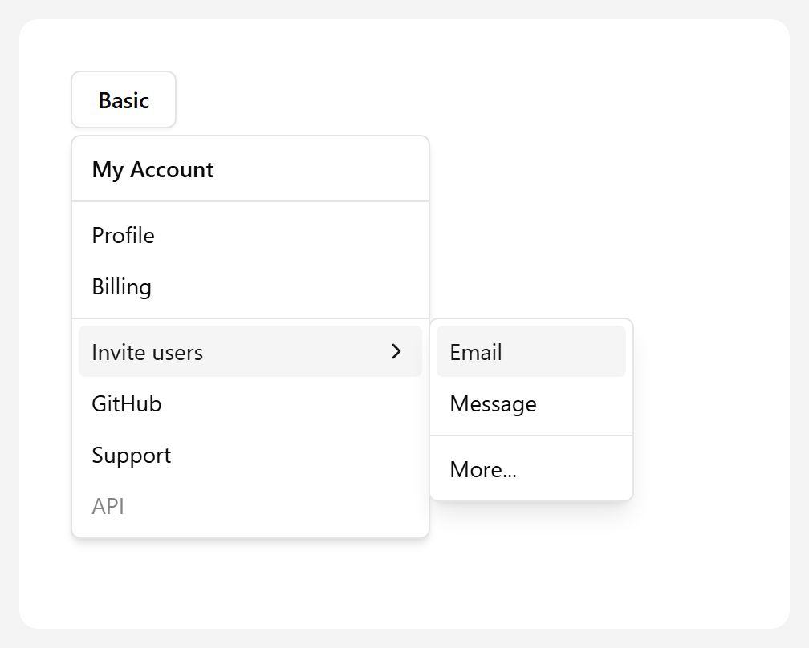

# Menus

General UI elements, not tied to any theme. The preview image is rendered from the CSS. After editing it, run `python elements/_preview/render.py` to refresh the image.

## Dropdown menu

Plain-CSS equivalent of shadcn/ui `DropdownMenu` (shadcn studio "dropdown-menu-01"). It's a list of actions that opens from a button, with labelled groups, separators, a submenu and disabled items.

CSS: [dropdown-menu.css](dropdown-menu.css) (trigger uses [buttons.css](../buttons/buttons.css)) · Preview: [dropdown-menu.html](dropdown-menu.html) · shadcn source: [dropdown-menu-01.tsx](shadcn/dropdown-menu-01.tsx)

### How it works (no JavaScript)

- The menu is a native `popover`, opened by `<button popovertarget="id">`. The browser handles opening and closing, Esc and click-outside.
- The menu sits under its trigger using CSS anchor positioning, and flips if there's no room. Give each trigger and menu pair the same unique `--menu-anchor` name.
- Submenus (`.menu__sub`) open on hover or keyboard focus.

### Spec

| Part                | Class              | Style                                                                   |
|---------------------|--------------------|-------------------------------------------------------------------------|
| Menu panel          | `.menu` (`.menu--w56` = 224px) | white, 1px `#E5E5E5` border, 6px radius, 4px padding, shadow-md, min 128px wide |
| Group label         | `.menu__label`     | 14px medium, 6px × 8px padding                                          |
| Item                | `.menu__item`      | 14px, 6px × 8px padding, 4px radius; hover/focus background `#F5F5F5`   |
| Disabled item       | `disabled`         | 50% opacity, not clickable                                              |
| Separator           | `.menu__separator` | 1px `#E5E5E5`, spans the full panel width, 4px space above and below    |
| Submenu             | `.menu__sub` > item + `.menu` | opens 4px to the right, shadow-lg; its trigger stays highlighted while open |
| Shortcut (optional) | `.menu__shortcut`  | right-aligned, 12px `#737373`                                           |

### Still to review

- **Browser support:** CSS anchor positioning works in current Chrome, Edge and Safari. In browsers without it, the menu opens in the centre of the screen. Test in your target browsers.
- **Keyboard:** arrow-key navigation between items isn't built in. Tab works, but the full menu keyboard pattern (arrows, typing to jump to an item) needs a small script, or use shadcn in React projects.
