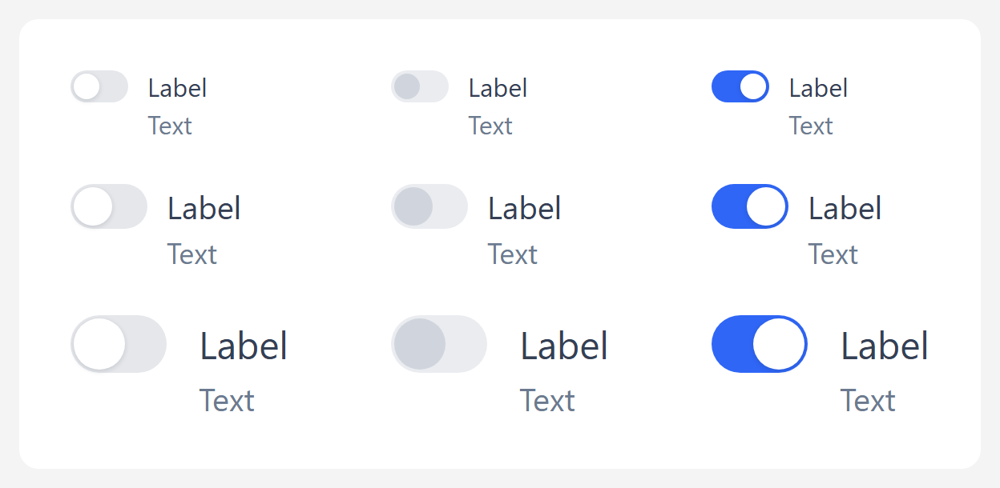
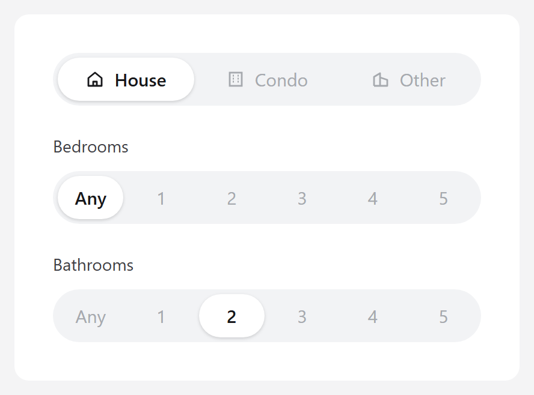
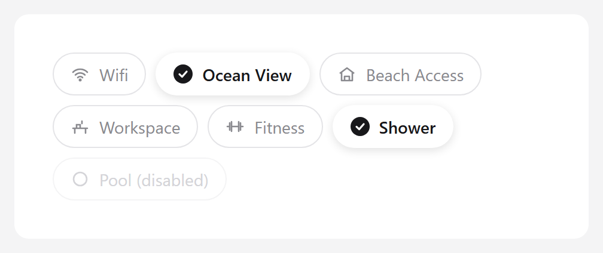

# Toggles

General UI elements, not tied to any theme. Each one is defined by a CSS file in this folder. The preview image next to it is rendered from that CSS, so the image and the code stay in sync.

Themes restyle an element by overriding its CSS variables (`--toggle-*`, `--seg-*`, `--chip-*`); they don't edit these files.

> Values are estimated from reference screenshots and still need checking against the source design.
> After editing any CSS here, run `python elements/_preview/render.py` to refresh the images.

Font for all toggles: Inter (fallback: Segoe UI / system sans-serif).

---

## Switch

On/off toggle for a single setting. A pill-shaped track with a round knob, next to a label and optional supporting text.

CSS: [switch.css](switch.css) · Preview: [switch.html](switch.html)

| State    | Track              | Knob                       | Knob position |
|----------|--------------------|----------------------------|---------------|
| Off      | `#E5E7EB`          | `#FFFFFF`, soft shadow     | left          |
| Disabled | `#EAECF0`          | `#D0D5DD`, no shadow       | left          |
| On       | `#2F66F6`          | `#FFFFFF`                  | right         |

| Size   | Class          | Track (w × h) | Knob  | Gap to label | Label | Supporting text |
|--------|----------------|---------------|-------|--------------|-------|-----------------|
| Small  | `.toggle`      | 36 × 20 px    | 16 px | 12 px        | 16 px | 16 px           |
| Medium | `.toggle--md`  | 48 × 28 px    | 24 px | 12 px        | 20 px | 18 px           |
| Large  | `.toggle--lg`  | 60 × 36 px    | 32 px | 20 px        | 24 px | 20 px           |

- Label `#344054`; supporting text `#6B7A90`, left-aligned under the label.
- Knob inset 2px; slides in about 150ms.
- Markup: `role="switch"` with `aria-checked`, plus `aria-disabled="true"` when disabled.

---

## Segmented toggle (single choice)

A row of options inside one pill-shaped track. Exactly one option is selected, shown as a raised white pill. Use it for a small, fixed set of mutually exclusive values, such as property type or number of bedrooms.

CSS: [segmented.css](segmented.css) · Preview: [segmented.html](segmented.html)

| State      | Background                       | Text / icon                 |
|------------|----------------------------------|-----------------------------|
| Selected   | `#FFFFFF` pill, soft shadow      | `#18181B`, medium weight    |
| Unselected | none (track `#F2F3F5` shows)     | `#A6A9AE`                   |
| Hover      | none                             | `#71717A`                   |
| Disabled   | none                             | `#D4D4D8`, not clickable    |

- Track: 4px inner padding, options 36px high (44px overall), equal widths, 15px text.
- Optional 16px leading line icon, in the same colour as the text.
- Group label above: `#3F3F46`, 14px, with a 12px gap to the track.
- Markup: `role="radiogroup"` with `role="radio"` and `aria-checked` on each option. Still to do: arrow-key navigation.

---

## Multi-select toggle (chips)

A wrapping group of pill-shaped chips. Any number of chips can be on at once. Use it for optional features, such as amenities or tags.

CSS: [multiselect.css](multiselect.css) · Preview: [multiselect.html](multiselect.html)

| State    | Border            | Shadow                     | Icon                                     | Text                     |
|----------|-------------------|----------------------------|------------------------------------------|--------------------------|
| Off      | 1px `#E4E4E7`     | none                       | 16px line icon, `#8A8A8F`                | `#8A8A8F`                |
| Hover    | 1px `#D4D4D8`     | none                       | `#52525B`                                | `#52525B`                |
| On       | none              | `0 2px 8px rgba(0,0,0,.12)`| 16px `#18181B` circle with a white check | `#18181B`, medium weight |
| Disabled | 1px `#F4F4F5`     | none                       | `#D4D4D8`                                | `#D4D4D8`                |

- Chip: 36px high, 14px horizontal padding, 8px gap between icon and text, 14px text, white background.
- Chips wrap with an 8px gap in both directions.
- Markup: a `<button>` per chip with `aria-pressed`, inside a `role="group"` labelled by its title.
